# Phase 3 results

30 October 2026 · KGI CU league · 9–30 September development sample

[PDF](phase-3-results.pdf) · [Raw comparison CSV](phase-3-results.csv) · [Evidence JSON](phase-3-results.json)

0/10 strategies pass the measured common criteria; 0/10 pass the Best Alpha checks; 10/10 meet the requested 70–80% average exposure band. The development lead under the declared ranking is C3 (Efficient breakout): net return -3.590%, excess +0.510 pp, drawdown 4.310%, average exposure 74.154%.

No prize-ready winner is established. All ten hypotheses were fixed before this comparison, but September was already inspected in earlier work. The ranking is development evidence only; no parameter search or retrospective change was made after these results. The original alphabetical default remains the reproducible engineering reference; a suite strategy runs through its explicit configuration.

The original reference returned -2.992% at 69.694% average exposure. The new-suite lead differs by -0.598 pp of net return. Different baskets and exposure mean this is a practical portfolio comparison, not an isolated signal effect.

## Comparable results

SET50 returned -4.099496% and its maximum drawdown was 4.099496%. The strict common drawdown boundary is therefore 6.149244%. Statuses use unrounded values. Drawdowns are positive loss magnitudes; return and excess retain their signs.

| ID | Net % | SET50 % | Excess pp | MaxDD % | SET50 MaxDD % | Avg exposure % |
| --- | --- | --- | --- | --- | --- | --- |
| C1 | -4.362 | -4.099 | -0.262 | 4.884 | 4.099 | 74.869 |
| C2 | -3.710 | -4.099 | 0.389 | 3.718 | 4.099 | 74.668 |
| C3 | -3.590 | -4.099 | 0.510 | 4.310 | 4.099 | 74.154 |
| C4 | -5.263 | -4.099 | -1.163 | 5.288 | 4.099 | 74.254 |
| C5 | -4.855 | -4.099 | -0.756 | 5.268 | 4.099 | 74.396 |
| T1 | -4.324 | -4.099 | -0.224 | 4.350 | 4.099 | 74.123 |
| T2 | -4.213 | -4.099 | -0.113 | 4.754 | 4.099 | 74.899 |
| T3 | -4.290 | -4.099 | -0.190 | 4.701 | 4.099 | 72.087 |
| T4 | -4.570 | -4.099 | -0.470 | 4.464 | 4.099 | 74.689 |
| T5 | -5.107 | -4.099 | -1.008 | 4.416 | 4.099 | 73.351 |

| ID | Stocks | FIFO lots | Payoff THB | Fees THB | Common | Best Alpha | 70–80% |
| --- | --- | --- | --- | --- | --- | --- | --- |
| C1 | 10 | 25 | -1,125.90 | 17,949.69 | fail | fail | yes |
| C2 | 10 | 5 | -977.95 | 15,459.78 | fail | fail | yes |
| C3 | 10 | 34 | -603.88 | 19,905.19 | fail | fail | yes |
| C4 | 10 | 39 | -360.27 | 18,002.79 | fail | fail | yes |
| C5 | 10 | 39 | -825.33 | 19,214.41 | fail | fail | yes |
| T1 | 10 | 17 | -472.03 | 15,515.93 | fail | fail | yes |
| T2 | 10 | 25 | -393.96 | 16,227.38 | fail | fail | yes |
| T3 | 10 | 61 | -618.61 | 23,953.53 | fail | fail | yes |
| T4 | 10 | 54 | -654.89 | 26,261.28 | fail | fail | yes |
| T5 | 10 | 72 | -2,221.38 | 33,162.82 | fail | fail | yes |

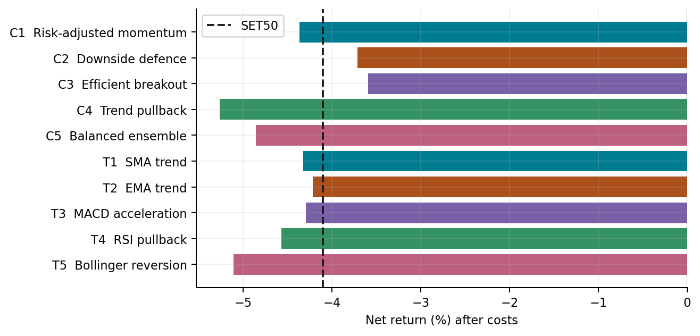

## Return paths, risk and exposure

Return charts use initial capital for strategies and the first sample close for SET50, matching official reporting. The first-day anchors differ; aligned first-close returns are available in the machine-readable evidence. Dates in charts are month-day, September 2026.

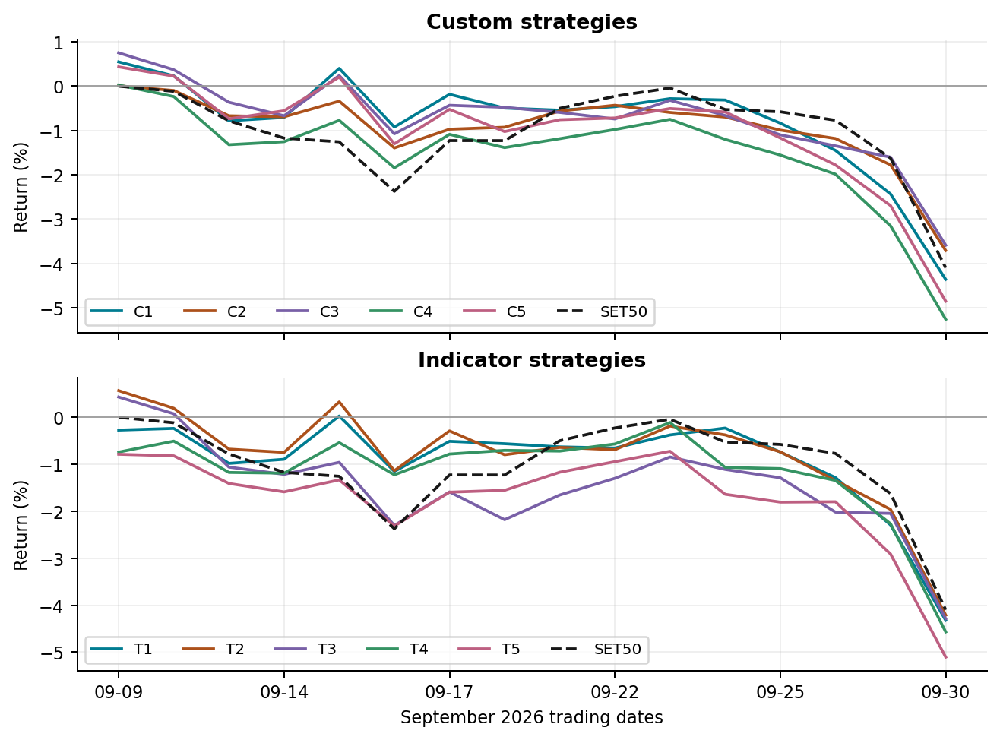

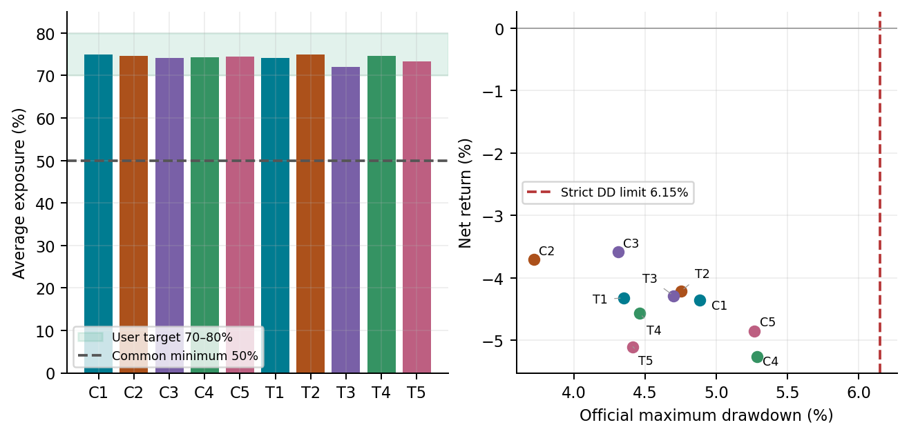

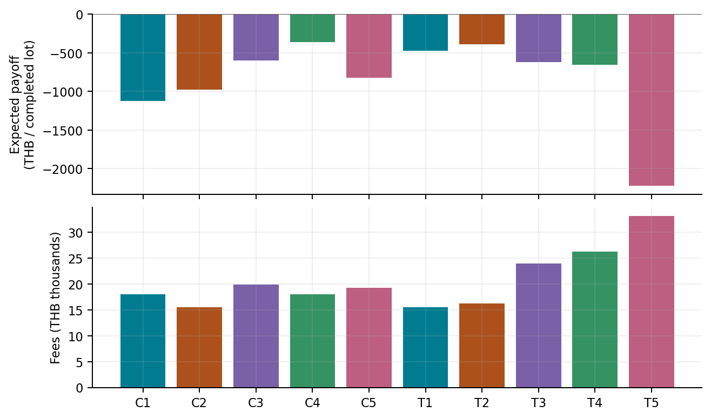

## Shared design and risk controls

1. One shared execution layer: THB 10 million, unchanged TradeSim 0.2.7, 16 supplied tick days (9–30 September 2026), 2,906,167 ticks per full run. All 48 supplied symbols are replayed in the original notebook symbol/row-index order, not globally sorted time.

2. Before September 9, use at most 180 prior daily bars and require at least 80 valid observations. Form the 30-stock pool with the highest median 20-session close × volume. Each signal selects ten stocks, at most two per sector. Freeze those names for the whole run; daily re-ranking changes weights only.

3. Normal target exposure is 76% of opening NAV. Ranked weights range from 9.12% to 6.08% per stock. Buy checks limit each position to 10%, total investment to 80%, and preserve 20% cash. Later price movements can exceed these pre-buy limits.

4. Opening drawdown guard lowers target to 72% at 2% portfolio drawdown or 1.2× SET50 drawdown when SET50 drawdown is at least 0.5%. It lowers target to 55% at 4% portfolio drawdown or 1.35× SET50 drawdown when SET50 drawdown is at least 1%. The guard uses drawdown observed so far, including initial capital for the portfolio, and does not reset a historical maximum after recovery.

5. Quantity targets use prior close and 100-share lots. Rebalance when the opening gap is at least 0.4% of NAV or the position is absent. Retry actual residual quantities at most once per symbol per 15-minute decision slot. Market IOC fills may be partial or zero. Costs are 0.157% commission plus 7% VAT on commission per side, and the official adverse price tick.

6. The drawdown guard is evaluated daily and remains subject to gaps and incomplete fills. It can reduce average exposure below the user’s 70–80% preference; that tradeoff is reported. There is no forced end-of-sample liquidation, cosmetic trade generation, or guarantee of eligibility.


These are ranked allocation models. They deliberately keep all ten selected names invested, rather than implementing binary crossover entry/exit systems. The basket cap is per simulation; the union across different strategies may exceed ten names.

## Strategy details

### C1 · Risk-adjusted momentum

Favor sustained gains that are large relative to day-to-day volatility. Blend the shorter trend with the longer trend to avoid relying on one lookback.

**Score:** (0.6 × return20 + 0.4 × return60) / (volatility20 × √20).

**Inputs:** 20- and 60-session returns; 20-session return volatility.

**Frozen basket / initial target weights:** BCP (9.12%), PTTGC (8.78%), KKP (8.44%), BBL (8.11%), PTT (7.77%), CPF (7.43%), IVL (7.09%), KTC (6.76%), CRC (6.42%), BH (6.08%).

| Metric | Value | Metric | Value |
| --- | --- | --- | --- |
| Net return | -4.362% | SET50 return | -4.099% |
| Excess return | -0.262 pp | SET50 MaxDD | 4.099% |
| Official MaxDD | 4.884% | Initial-capital MaxDD | 4.884% |
| Average exposure | 74.869% | Final exposure | 71.826% |
| Distinct stocks | 10 | Completed FIFO lots | 25 |
| Expected payoff | THB -1,125.90 | Fees | THB 17,949.69 |
| Realized P&L | THB -43,040.04 | Unrealized P&L | THB -393,149.65 |

Common: fail; Best Alpha: fail; user exposure band: met. Unmet common criteria: positive expected payoff. Target days: 76% target on 14 days, 72% target on 2 days.

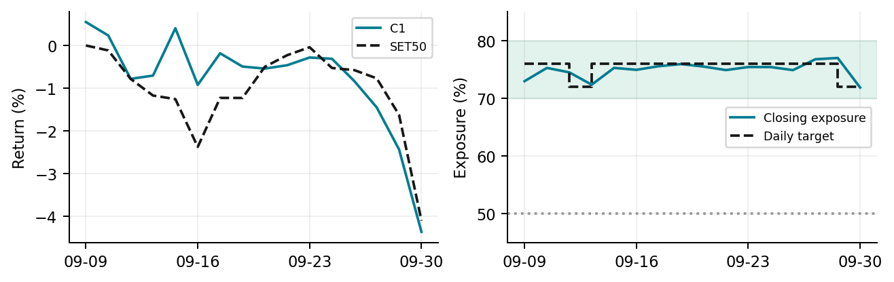

**Risk:** Momentum can reverse abruptly; low recent volatility does not imply low future risk.

Largest closing position: 9.39%. Maximum measured daily replay time: 26.57s. Timing is local and includes concurrent experiments; it is not a production guarantee.

### C2 · Downside defence

Favor stocks with smaller downside fluctuations and less positive sensitivity to SET50. This is a defensive allocation hypothesis, not a direct forecast of rising prices.

**Score:** −(annualized downside deviation20 + 0.1 × max(beta60, 0)).

**Inputs:** Negative daily returns over 20 sessions; up to 60 aligned stock/SET50 return intervals.

**Frozen basket / initial target weights:** PTT (9.12%), PTTEP (8.78%), SCB (8.44%), BBL (8.11%), BDMS (7.77%), CPF (7.43%), MINT (7.09%), TRUE (6.76%), IVL (6.42%), SCC (6.08%).

| Metric | Value | Metric | Value |
| --- | --- | --- | --- |
| Net return | -3.710% | SET50 return | -4.099% |
| Excess return | 0.389 pp | SET50 MaxDD | 4.099% |
| Official MaxDD | 3.718% | Initial-capital MaxDD | 3.718% |
| Average exposure | 74.668% | Final exposure | 74.503% |
| Distinct stocks | 10 | Completed FIFO lots | 5 |
| Expected payoff | THB -977.95 | Fees | THB 15,459.78 |
| Realized P&L | THB -14,365.47 | Unrealized P&L | THB -356,634.30 |

Common: fail; Best Alpha: fail; user exposure band: met. Unmet common criteria: positive expected payoff. Target days: 76% target on 16 days.

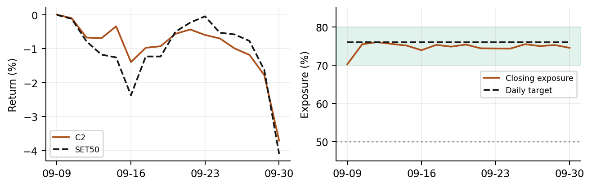

**Risk:** Low downside risk can lag a rebound. Beta is estimated from a short and changing sample.

Largest closing position: 9.17%. Maximum measured daily replay time: 27.02s. Timing is local and includes concurrent experiments; it is not a production guarantee.

### C3 · Efficient breakout

Favor prices near their previous 55-session high, especially when the path there was relatively direct. The efficiency term rewards persistent movement.

**Score:** (close / prior high55 − 1) / volatility20 + 0.5 × efficiency20.

**Inputs:** Previous 55-session high excluding the latest bar; 20-session volatility and path efficiency.

**Frozen basket / initial target weights:** IVL (9.12%), PTTGC (8.78%), PTT (8.44%), SCC (8.11%), PTTEP (7.77%), CPF (7.43%), CCET (7.09%), KKP (6.76%), CRC (6.42%), BH (6.08%).

| Metric | Value | Metric | Value |
| --- | --- | --- | --- |
| Net return | -3.590% | SET50 return | -4.099% |
| Excess return | 0.510 pp | SET50 MaxDD | 4.099% |
| Official MaxDD | 4.310% | Initial-capital MaxDD | 4.310% |
| Average exposure | 74.154% | Final exposure | 70.925% |
| Distinct stocks | 10 | Completed FIFO lots | 34 |
| Expected payoff | THB -603.88 | Fees | THB 19,905.19 |
| Realized P&L | THB -25,478.24 | Unrealized P&L | THB -333,471.95 |

Common: fail; Best Alpha: fail; user exposure band: met. Unmet common criteria: positive expected payoff. Target days: 76% target on 12 days, 72% target on 4 days.

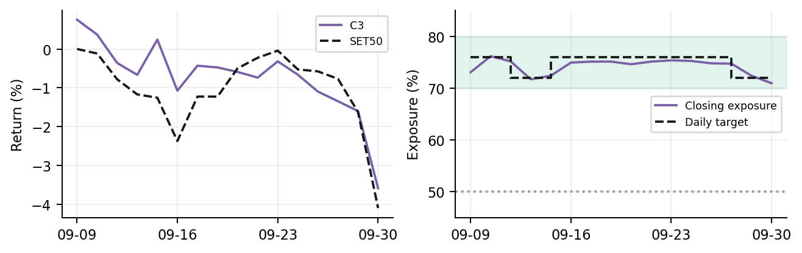

**Risk:** False breakouts and gaps can create losses before a daily risk guard reacts.

Largest closing position: 10.07%. Maximum measured daily replay time: 30.92s. Timing is local and includes concurrent experiments; it is not a production guarantee.

### C4 · Trend pullback

Favor a strong longer trend with a recent pullback. The recent return is subtracted to distinguish a potential recovery entry from a stretched move.

**Score:** (return60 − 2 × return5) / (volatility20 × √20).

**Inputs:** 60-session trend, 5-session pullback, and 20-session volatility.

**Frozen basket / initial target weights:** KBANK (9.12%), BBL (8.78%), BCP (8.44%), KTC (8.11%), GPSC (7.77%), CPF (7.43%), CRC (7.09%), PTTGC (6.76%), MTC (6.42%), BDMS (6.08%).

| Metric | Value | Metric | Value |
| --- | --- | --- | --- |
| Net return | -5.263% | SET50 return | -4.099% |
| Excess return | -1.163 pp | SET50 MaxDD | 4.099% |
| Official MaxDD | 5.288% | Initial-capital MaxDD | 5.288% |
| Average exposure | 74.254% | Final exposure | 71.064% |
| Distinct stocks | 10 | Completed FIFO lots | 39 |
| Expected payoff | THB -360.27 | Fees | THB 18,002.79 |
| Realized P&L | THB -32,288.52 | Unrealized P&L | THB -493,979.27 |

Common: fail; Best Alpha: fail; user exposure band: met. Unmet common criteria: positive expected payoff. Target days: 76% target on 13 days, 72% target on 3 days.

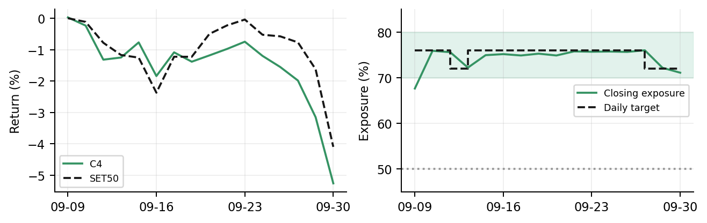

**Risk:** A pullback can mark a lasting trend reversal. This score has no guarantee of mean reversion.

Largest closing position: 9.39%. Maximum measured daily replay time: 28.86s. Timing is local and includes concurrent experiments; it is not a production guarantee.

### C5 · Balanced ensemble

Combine the cross-sectional ranks of the four custom signals equally. This reduces dependence on a single scoring formula, while keeping the decision explainable.

**Score:** Mean percentile rank of C1, C2, C3 and C4.

**Inputs:** All custom features; average ranks for ties. Daily ranks use the frozen ten-stock basket.

**Frozen basket / initial target weights:** PTT (9.12%), KBANK (8.78%), PTTGC (8.44%), CPF (8.11%), BCP (7.77%), KKP (7.43%), IVL (7.09%), BDMS (6.76%), SCC (6.42%), KTC (6.08%).

| Metric | Value | Metric | Value |
| --- | --- | --- | --- |
| Net return | -4.855% | SET50 return | -4.099% |
| Excess return | -0.756 pp | SET50 MaxDD | 4.099% |
| Official MaxDD | 5.268% | Initial-capital MaxDD | 5.268% |
| Average exposure | 74.396% | Final exposure | 70.977% |
| Distinct stocks | 10 | Completed FIFO lots | 39 |
| Expected payoff | THB -825.33 | Fees | THB 19,214.41 |
| Realized P&L | THB -47,213.84 | Unrealized P&L | THB -438,290.57 |

Common: fail; Best Alpha: fail; user exposure band: met. Unmet common criteria: positive expected payoff. Target days: 76% target on 13 days, 72% target on 3 days.

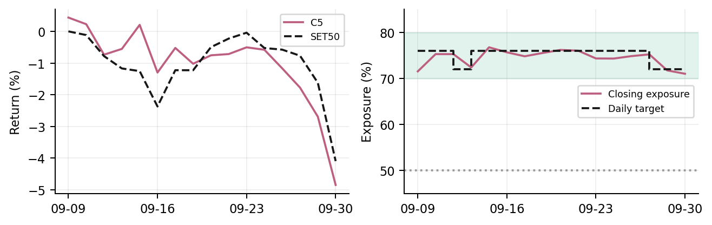

**Risk:** The components overlap and can fail together; averaging ranks can dilute a useful signal.

Largest closing position: 9.35%. Maximum measured daily replay time: 32.25s. Timing is local and includes concurrent experiments; it is not a production guarantee.

### T1 · SMA trend

Favor a 20-session simple moving average above the 60-session average, scaled by volatility. This is a slower trend allocation.

**Score:** (SMA20 / SMA60 − 1) / volatility20.

**Inputs:** 20- and 60-close simple moving averages; 20-session daily return volatility.

**Frozen basket / initial target weights:** BCP (9.12%), KBANK (8.78%), PTT (8.44%), PTTGC (8.11%), CPF (7.77%), TTB (7.43%), CRC (7.09%), KTC (6.76%), BH (6.42%), BDMS (6.08%).

| Metric | Value | Metric | Value |
| --- | --- | --- | --- |
| Net return | -4.324% | SET50 return | -4.099% |
| Excess return | -0.224 pp | SET50 MaxDD | 4.099% |
| Official MaxDD | 4.350% | Initial-capital MaxDD | 4.350% |
| Average exposure | 74.123% | Final exposure | 72.458% |
| Distinct stocks | 10 | Completed FIFO lots | 17 |
| Expected payoff | THB -472.03 | Fees | THB 15,515.93 |
| Realized P&L | THB -13,124.49 | Unrealized P&L | THB -419,233.44 |

Common: fail; Best Alpha: fail; user exposure band: met. Unmet common criteria: positive expected payoff. Target days: 76% target on 14 days, 72% target on 2 days.

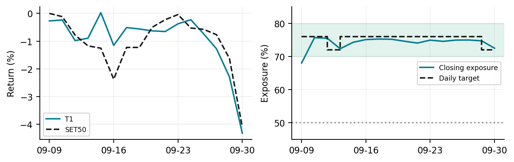

**Risk:** Moving averages lag turning points and can repeatedly change ranks in sideways markets.

Largest closing position: 9.36%. Maximum measured daily replay time: 30.42s. Timing is local and includes concurrent experiments; it is not a production guarantee.

### T2 · EMA trend

Use faster exponential averages to emphasize recent price information. Allocate more to a stronger normalized separation between the two averages.

**Score:** (EMA12 − EMA26) / (close × volatility20).

**Inputs:** 12- and 26-session EMAs; 20-session volatility. EMA alpha = 2 / (period + 1).

**Frozen basket / initial target weights:** BCP (9.12%), PTTGC (8.78%), PTT (8.44%), IVL (8.11%), KKP (7.77%), CPF (7.43%), KBANK (7.09%), CCET (6.76%), BDMS (6.42%), CRC (6.08%).

| Metric | Value | Metric | Value |
| --- | --- | --- | --- |
| Net return | -4.213% | SET50 return | -4.099% |
| Excess return | -0.113 pp | SET50 MaxDD | 4.099% |
| Official MaxDD | 4.754% | Initial-capital MaxDD | 4.754% |
| Average exposure | 74.899% | Final exposure | 72.182% |
| Distinct stocks | 10 | Completed FIFO lots | 25 |
| Expected payoff | THB -393.96 | Fees | THB 16,227.38 |
| Realized P&L | THB -21,927.17 | Unrealized P&L | THB -399,355.21 |

Common: fail; Best Alpha: fail; user exposure band: met. Unmet common criteria: positive expected payoff. Target days: 76% target on 14 days, 72% target on 2 days.

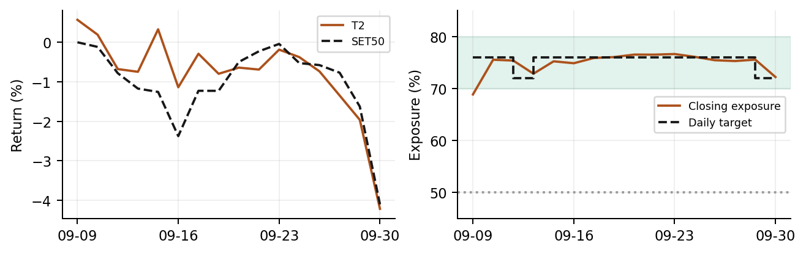

**Risk:** Faster reactions can produce more turnover and false signals after brief moves.

Largest closing position: 9.61%. Maximum measured daily replay time: 35.48s. Timing is local and includes concurrent experiments; it is not a production guarantee.

### T3 · MACD acceleration

Combine MACD acceleration with a smaller contribution from the underlying trend. A rising histogram can identify improving momentum before a slow crossover.

**Score:** (MACD histogram + 0.25 × MACD line) / (close × volatility20).

**Inputs:** MACD line = EMA12 − EMA26; signal = EMA9 of MACD; histogram = line − signal.

**Frozen basket / initial target weights:** IVL (9.12%), PTTGC (8.78%), BCP (8.44%), PTT (8.11%), CCET (7.77%), BDMS (7.43%), DELTA (7.09%), KKP (6.76%), SCC (6.42%), BBL (6.08%).

| Metric | Value | Metric | Value |
| --- | --- | --- | --- |
| Net return | -4.290% | SET50 return | -4.099% |
| Excess return | -0.190 pp | SET50 MaxDD | 4.099% |
| Official MaxDD | 4.701% | Initial-capital MaxDD | 4.701% |
| Average exposure | 72.087% | Final exposure | 71.185% |
| Distinct stocks | 10 | Completed FIFO lots | 61 |
| Expected payoff | THB -618.61 | Fees | THB 23,953.53 |
| Realized P&L | THB -71,046.99 | Unrealized P&L | THB -357,941.55 |

Common: fail; Best Alpha: fail; user exposure band: met. Unmet common criteria: positive expected payoff. Target days: 55% target on 1 day, 76% target on 8 days, 72% target on 7 days.

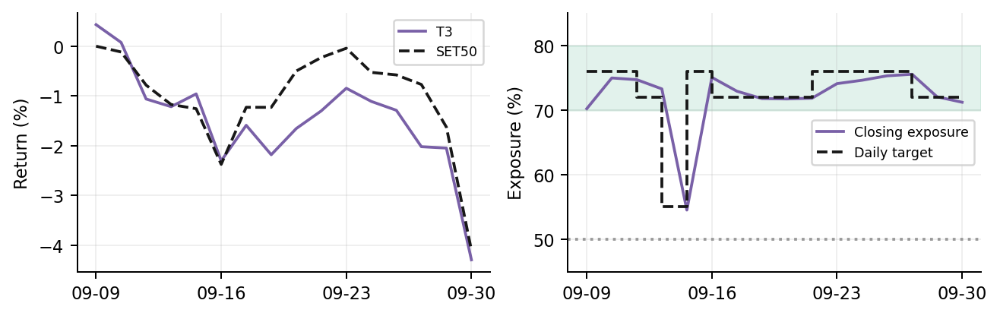

**Risk:** Acceleration can improve while prices still fall. Histogram changes are not proof of a reversal.

Largest closing position: 10.11%. Maximum measured daily replay time: 29.88s. Timing is local and includes concurrent experiments; it is not a production guarantee.

### T4 · RSI pullback

Prefer RSI near 35, with an additional preference for stocks above their 60-session average. This seeks moderate oversold entries within a stronger trend.

**Score:** −(RSI14 − 35)² / 100 + (5 if close > SMA60, else 0).

**Inputs:** Wilder-smoothed 14-session RSI and 60-close simple moving average.

**Frozen basket / initial target weights:** GPSC (9.12%), TTB (8.78%), KTC (8.44%), KBANK (8.11%), BDMS (7.77%), MTC (7.43%), BH (7.09%), ADVANC (6.76%), CPN (6.42%), THAI (6.08%).

| Metric | Value | Metric | Value |
| --- | --- | --- | --- |
| Net return | -4.570% | SET50 return | -4.099% |
| Excess return | -0.470 pp | SET50 MaxDD | 4.099% |
| Official MaxDD | 4.464% | Initial-capital MaxDD | 4.570% |
| Average exposure | 74.689% | Final exposure | 70.974% |
| Distinct stocks | 10 | Completed FIFO lots | 54 |
| Expected payoff | THB -654.89 | Fees | THB 26,261.28 |
| Realized P&L | THB -87,163.07 | Unrealized P&L | THB -369,827.21 |

Common: fail; Best Alpha: fail; user exposure band: met. Unmet common criteria: positive expected payoff. Target days: 76% target on 14 days, 72% target on 2 days.

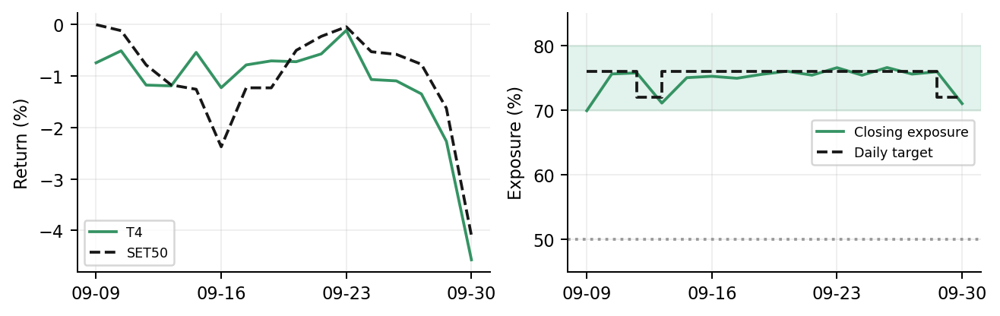

**Risk:** Oversold stocks can stay oversold; the trend bonus is a preference, not a mandatory filter.

Largest closing position: 9.35%. Maximum measured daily replay time: 43.21s. Timing is local and includes concurrent experiments; it is not a production guarantee.

### T5 · Bollinger reversion

Prefer a close around one standard deviation below its 20-session mean. Penalize falls beyond two deviations and favor prices above the longer average.

**Score:** −abs(z20 + 1) − 2 × max(−2 − z20, 0) + (1 if close > SMA60, else 0).

**Inputs:** z20 = (close − SMA20) / sample standard deviation of 20 closes; SMA60 trend preference.

**Frozen basket / initial target weights:** KBANK (9.12%), GPSC (8.78%), TTB (8.44%), KTC (8.11%), ADVANC (7.77%), AOT (7.43%), TRUE (7.09%), MTC (6.76%), THAI (6.42%), GULF (6.08%).

| Metric | Value | Metric | Value |
| --- | --- | --- | --- |
| Net return | -5.107% | SET50 return | -4.099% |
| Excess return | -1.008 pp | SET50 MaxDD | 4.099% |
| Official MaxDD | 4.416% | Initial-capital MaxDD | 5.107% |
| Average exposure | 73.351% | Final exposure | 70.991% |
| Distinct stocks | 10 | Completed FIFO lots | 72 |
| Expected payoff | THB -2,221.38 | Fees | THB 33,162.82 |
| Realized P&L | THB -172,507.93 | Unrealized P&L | THB -338,197.89 |

Common: fail; Best Alpha: fail; user exposure band: met. Unmet common criteria: positive expected payoff. Target days: 55% target on 1 day, 76% target on 12 days, 72% target on 3 days.

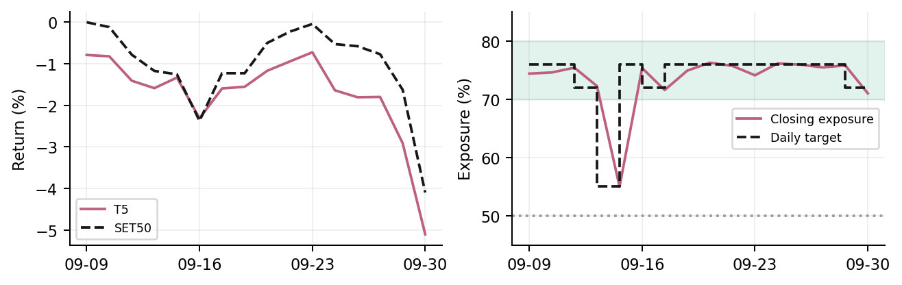

**Risk:** Price distributions need not be normal, and lower-band moves can become persistent declines.

Largest closing position: 9.27%. Maximum measured daily replay time: 35.14s. Timing is local and includes concurrent experiments; it is not a production guarantee.

## Metric explanations and your questions

### Payoff and expected payoff

A completed trade’s payoff is its net profit or loss after both-side costs. Here a trade means a fully closed FIFO buy lot. TradeSim expected payoff is the arithmetic mean P&L of completed non-breakeven lots: win fraction × mean win − loss fraction × mean loss magnitude. Six wins of THB 1,000 and four losses of THB 800 imply THB 280 per completed lot. It is an observed sample average, not a forecast. Partial closes of still-open lots affect realized P&L but not completed-lot payoff yet; zero completed non-flat lots means undefined.

### Simulation data

Yes: executions and valuation use the stock ticks supplied with TradeSim. Prior stock/SET50 daily history provides signals; the supplied SET50 benchmark file provides benchmark metrics. Each strategy gets the same dates, capital, costs and input package. Its selected basket and resulting trades differ. No synthetic prices are used for reported returns.

### Percent versus percentage points

A strategy return of 3% minus a benchmark return of 1% is 2 percentage points (2 pp) of excess return. Both inputs are percentages; their arithmetic difference is reported in pp. This is not the compounded wealth ratio (1.03 / 1.01 − 1).

### Return and drawdown anchors

Net return is final NAV / initial THB 10 million − 1. SET50 return uses the first sample close. Official maximum drawdown uses daily closing peaks and therefore excludes an initial-capital peak before the first close. Initial-capital drawdown and aligned first-close returns are also saved separately. Intraday drawdown is not this official metric.

### Exposure and counts

Average exposure is the mean of the 16 daily closing invested-value / NAV fractions, including the first day. It is not the target, final value or time-weighted intraday exposure. Distinct stocks counts unique names with fills. Completed FIFO lots can be numerous because IOC orders create many small lots; their count is not a count of independent investment ideas.

### Prize conditions

Working common criteria: portfolio MaxDD strictly below 1.5× SET50 MaxDD, at least five completed FIFO lots, average exposure at least 50%, and expected payoff above zero. At least five distinct stocks is tracked separately. Positive total return is not a universal common requirement. Best Alpha additionally requires nonnegative total and excess returns. Passing these local checks is not organizer acceptance or a prize guarantee.

## Earlier runs: historical context

| Earlier run | Net % | Exposure % | FIFO lots | Payoff THB | Common |
| --- | --- | --- | --- | --- | --- |
| Original reference | -2.992 | 69.694 | 0 | Undefined | fail |
| Alphabetical + exits | -4.228 | 57.033 | 349 | -999.31 | fail |
| Momentum + exits | -5.551 | 54.948 | 378 | -1,390.41 | fail |

These earlier runs use different allocation/exit designs. Full earlier metrics and evidence remain in [the follow-up](../phase-3-followup.md).

## Evidence and limitations

61 automated tests pass, including the original 17 TradeSim contract tests and indicator mathematics checked independently against pandas. Daily accounting reconciles for all 160 strategy-days. Repeatability: pass. C1 was replayed in a fresh process; all 9 deterministic artifacts match byte for byte. The original Phase 2 sources and pinned package remain unchanged. Full run bundles stay under ignored artifacts/; compact metrics, daily series and hashes are committed with this report.

Only 16 trading days are available for tick-level evaluation, and this sample has been reused. The supplied 48-stock universe is static; historical membership and price-adjustment semantics are not independently established. Cross-symbol marks are not synchronized under notebook event ordering. Closing drawdown omits intraday extremes. No robustness, out-of-sample, production acceptance or future-return claim is made. A ten-stock basket limits diversification and replacement choices; expanding it belongs to a later declared experiment.

## Reproduce

```bash
uv pip install --python .venv/bin/python -r requirements-reporting.txt
.venv/bin/python -m unittest discover -s tests -v
.venv/bin/python scripts/run_strategy_suite.py --output artifacts/comparison --workers 3
.venv/bin/python scripts/run_phase3.py --config research/phase3-suite/C1.json --output artifacts/repeat
.venv/bin/python scripts/build_phase3_results.py --input artifacts/comparison --repeat artifacts/repeat
```

Install the pinned TradeSim environment first; see [README](../../README.md). Regenerate baskets into a new directory with `scripts/prepare_strategy_suite.py --output artifacts/prepared-baskets`.

## Phase status and handoff

Phase 3 is complete as the local engineering milestone described in the guide. The ten-strategy research scaffold is also complete. Phase 4 validation and a prize-ready strategy are not established.

[Current achievements](../current-progress/README.md) · [Next actions and lessons](../to-do/README.md) · [Working rules](../award-criteria.md) · [Predeclared specification](../phase-3-ten-strategy-spec.md)
