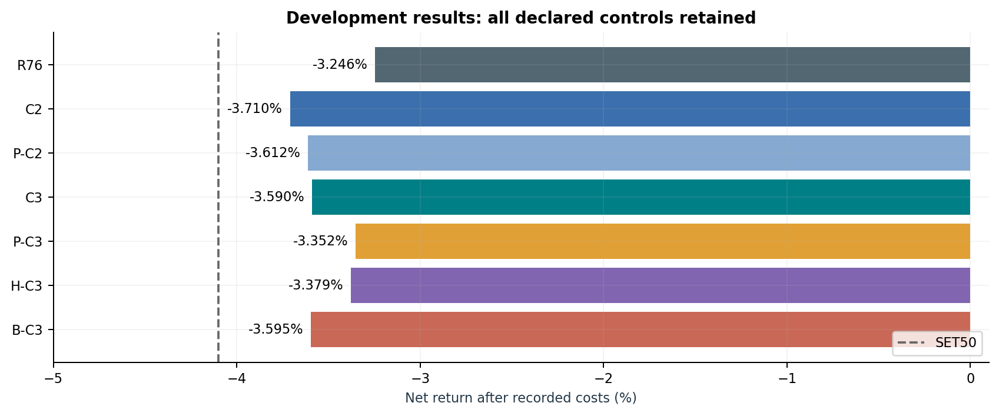
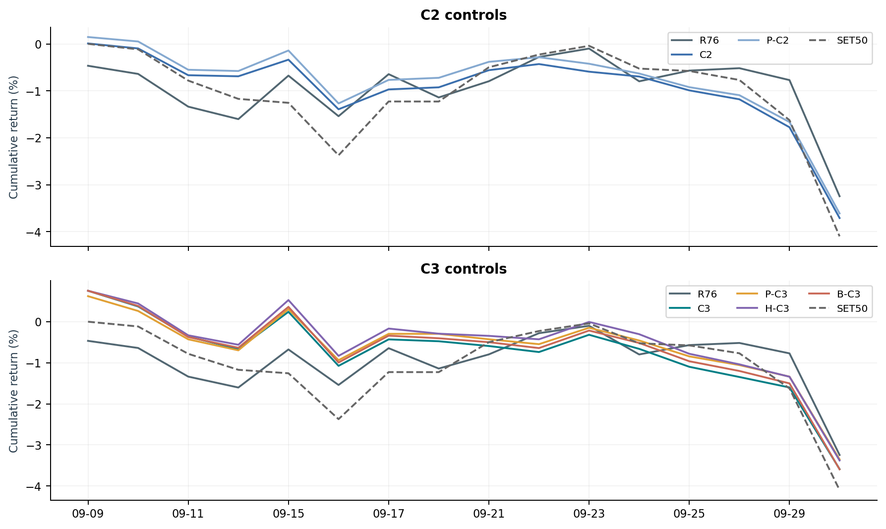
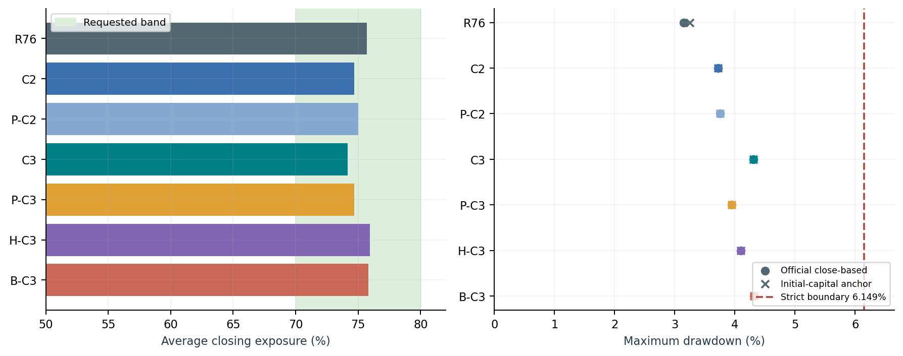
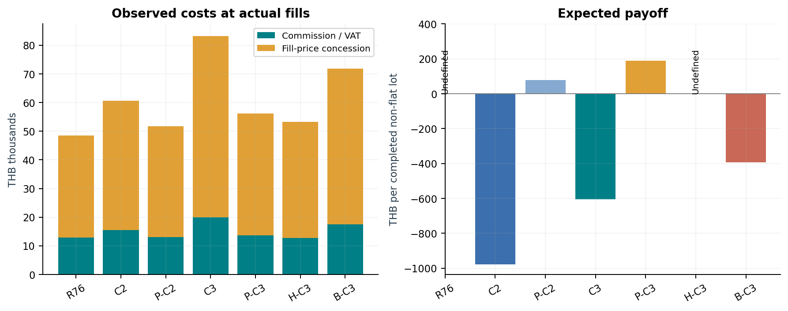
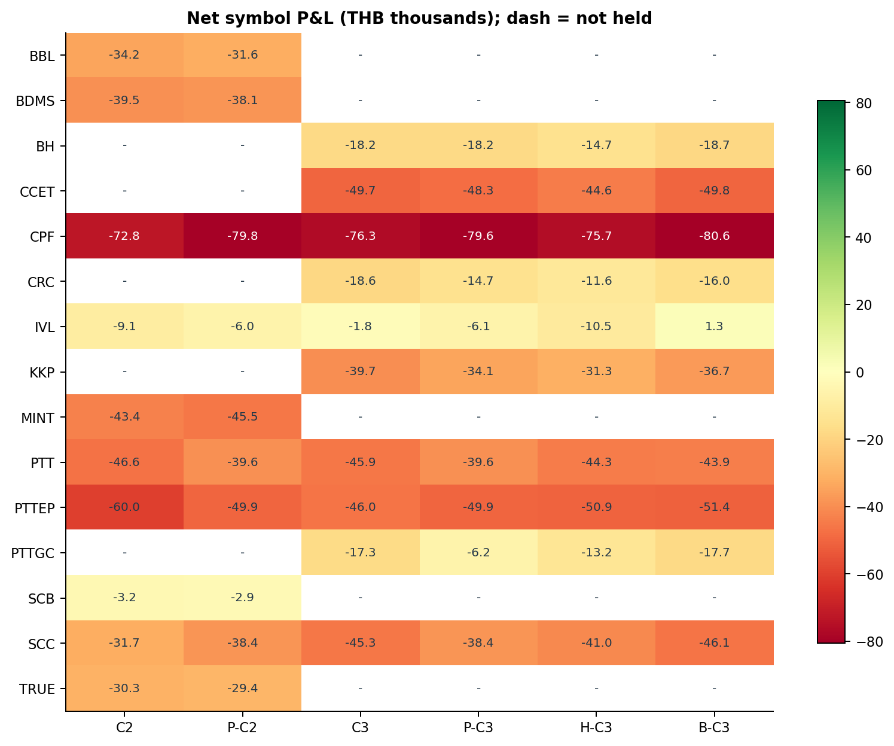
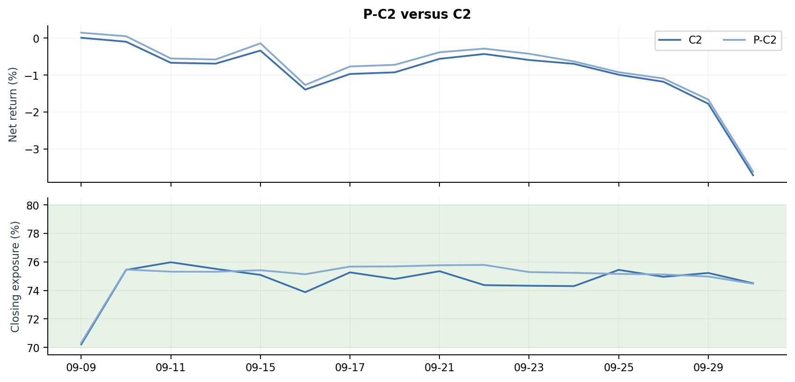
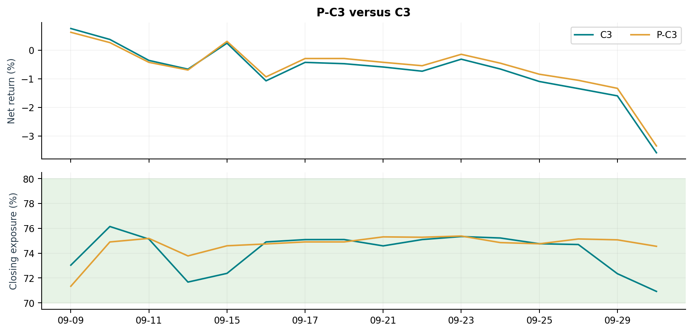
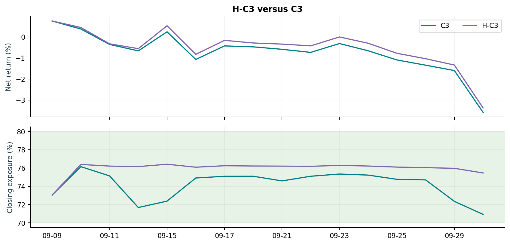
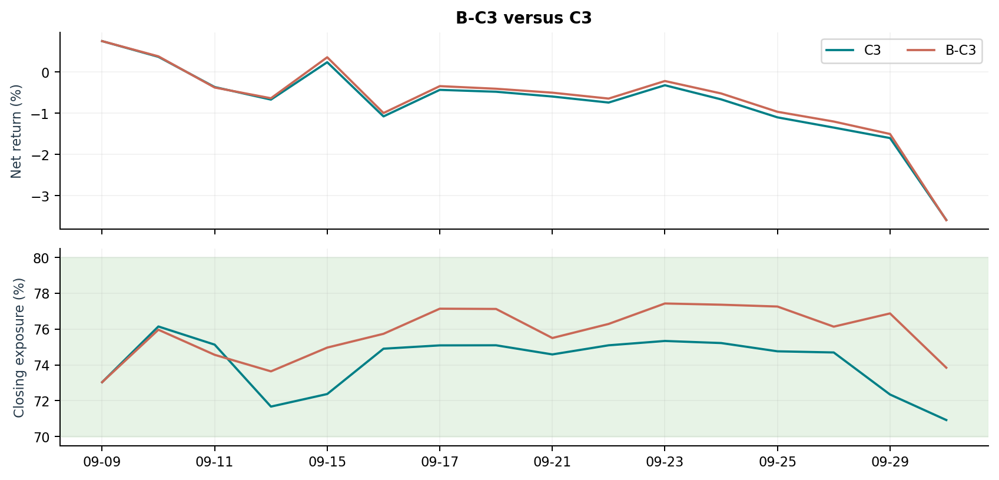
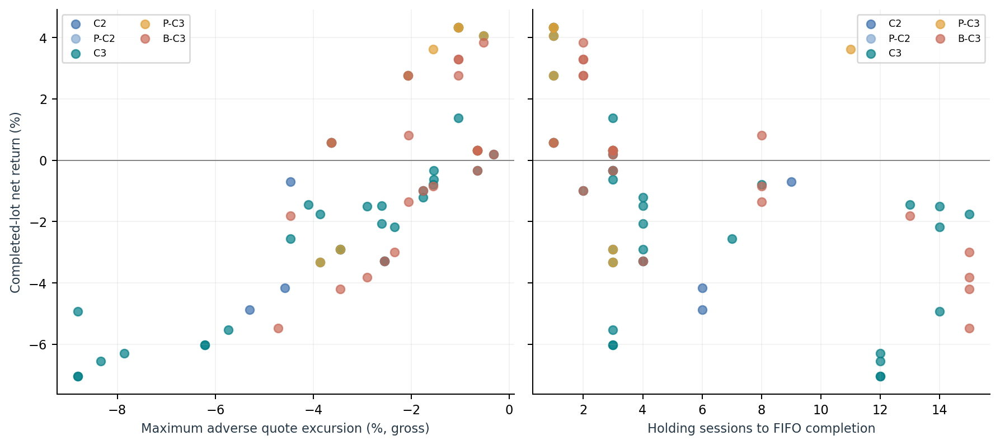

# Phase 4 results

30 October 2026 · KGI CU league · September development sample

[PDF](phase-4-results.pdf) · [CSV](phase-4-results.csv) · [Evidence JSON](phase-4-results.json)

1/7 compared portfolios pass the common criteria. No candidate is promoted. The declared development comparisons are complete; independent chronological validation remains blocked.

P-C3, equal weights in the C3 basket, has common status pass: 10 completed lots and THB 189.26 expected payoff. Its net return is -3.352153%, versus R76 at -3.245602%. It fails Best Alpha and does not beat R76.

Phase 4 is not fully complete. The engineering, diagnostics and declared September experiments are complete. No additional permitted tick period or effective-dated membership is available, so the validation checkpoint cannot be certified. The original reference remains the fallback; entry into Phase 5 is not a claim of validated alpha.

## Comparable metrics

| ID | Net % | Excess pp | MaxDD % | Exposure % | FIFO | Payoff THB |
| --- | --- | --- | --- | --- | --- | --- |
| R76 | -3.246 | 0.854 | 3.149 | 75.691 | 0 | Undefined |
| C2 | -3.710 | 0.389 | 3.718 | 74.668 | 5 | -977.95 |
| P-C2 | -3.612 | 0.487 | 3.752 | 75.011 | 1 | 78.59 |
| C3 | -3.590 | 0.510 | 4.310 | 74.154 | 34 | -603.88 |
| P-C3 | -3.352 | 0.747 | 3.949 | 74.671 | 10 | 189.26 |
| H-C3 | -3.379 | 0.721 | 4.101 | 75.951 | 0 | Undefined |
| B-C3 | -3.595 | 0.504 | 4.316 | 75.808 | 20 | -393.04 |

SET50 return and drawdown: −4.099496% and 4.099496%. The strict portfolio drawdown boundary is 6.149244%. Exposure is the mean of 16 daily closes. Payoff is per completed non-breakeven FIFO lot, not a forecast.

## Paths, risk and costs

Official portfolio return starts at initial capital; SET50 starts at its first sample close. First-close-aligned excess and initial-capital drawdown are retained separately in the tables below and JSON. Price concession is measured against the execution tick quote. Fixed-fill add-backs and fee stresses do not simulate changed execution.

## Symbol attribution

## Additional anchors and eligibility

| ID | Common | Best Alpha | Aligned excess pp | Initial-capital DD % |
| --- | --- | --- | --- | --- |
| R76 | fail | fail | 1.308 | 3.246 |
| C2 | fail | fail | 0.381 | 3.718 |
| P-C2 | fail | fail | 0.347 | 3.752 |
| C3 | fail | fail | -0.211 | 4.310 |
| P-C3 | pass | fail | 0.150 | 3.949 |
| H-C3 | fail | fail | -0.002 | 4.101 |
| B-C3 | fail | fail | -0.217 | 4.316 |

The original 70%-target reference returned -2.991564% at 69.693722% average exposure. R76 changes net return by -0.254039 pp. The original remains the engineering fallback; neither reference has completed-lot payoff evidence.

## P-C2: C2 basket, equal weights

Replace daily ranked weights with equal weights in the same C2 basket; retain the guard and execution rules.

| Metric | Value | Metric | Value |
| --- | --- | --- | --- |
| Net return | -3.612% | Average exposure | 75.011% |
| Official drawdown | 3.752% | SET50 excess | 0.487 pp |
| Completed lots | 1 | Expected payoff | 78.59 THB |
| Realized P&L | 3,453.39 | Unrealized P&L | -364,654.81 |

Net return change versus C2: +0.097983 pp; average exposure change: +0.342622 pp; commission/VAT change: THB -2,388.35. Decision: retain as development hypothesis only. No promotion.

The basket, initial capital, cost model and execution order match the paired reference. Guard triggers can differ as portfolio paths diverge; this is part of the resulting behavior.

## P-C3: C3 basket, equal weights

Replace daily ranked weights with equal weights in the same C3 basket; retain the guard and execution rules.

| Metric | Value | Metric | Value |
| --- | --- | --- | --- |
| Net return | -3.352% | Average exposure | 74.671% |
| Official drawdown | 3.949% | SET50 excess | 0.747 pp |
| Completed lots | 10 | Expected payoff | 189.26 THB |
| Realized P&L | 2,821.12 | Unrealized P&L | -338,036.41 |

Net return change versus C3: +0.237349 pp; average exposure change: +0.517373 pp; commission/VAT change: THB -6,214.90. Decision: retain as development hypothesis only. No promotion.

The basket, initial capital, cost model and execution order match the paired reference. Guard triggers can differ as portfolio paths diverge; this is part of the resulting behavior.

## H-C3: C3 initial quantities, passive

Freeze C3 initial quantities from pre-start features. Retry residual initial buys; do not sell or apply later daily de-risking.

| Metric | Value | Metric | Value |
| --- | --- | --- | --- |
| Net return | -3.379% | Average exposure | 75.951% |
| Official drawdown | 4.101% | SET50 excess | 0.721 pp |
| Completed lots | 0 | Expected payoff | Undefined THB |
| Realized P&L | 0.00 | Unrealized P&L | -337,869.16 |

Net return change versus C3: +0.210810 pp; average exposure change: +1.797387 pp; commission/VAT change: THB -7,111.03. Decision: retain as development hypothesis only. No promotion.

The passive comparison changes both ongoing allocation and the guard. It cannot isolate the value of reranking alone. No terminal sales were forced.

## B-C3: C3 with 0.8% rebalance band

Widen only the C3 rebalance activation band from 0.4% to 0.8% of opening NAV; continue actual residual fills once active.

| Metric | Value | Metric | Value |
| --- | --- | --- | --- |
| Net return | -3.595% | Average exposure | 75.808% |
| Official drawdown | 4.316% | SET50 excess | 0.504 pp |
| Completed lots | 20 | Expected payoff | -393.04 THB |
| Realized P&L | -22,733.17 | Unrealized P&L | -336,799.51 |

Net return change versus C3: -0.005825 pp; average exposure change: +1.653692 pp; commission/VAT change: THB -2,367.52. Decision: reject change on current development evidence. No promotion.

The basket, initial capital, cost model and execution order match the paired reference. Guard triggers can differ as portfolio paths diverge; this is part of the resulting behavior.

## Completed-lot price paths

Each dot is one completed FIFO buy lot, not an independent investment idea. Quote MAE/MFE use the first buy through final close, relative to the gross average buy fill price. Known entry/exit quotes and strictly interior timestamps exclude ambiguous other ticks at the same boundary times. Quotes include auctions; commissions, exit slippage and shrinking quantities after partial sales are not modeled by this path measure. This is retrospective diagnosis, never a strategy input or an executable liquidation return. Still-open lots are excluded.

## Verification and phase status

86 tests pass. All 90 deterministic artifacts from ten restored Phase 3 runs match their committed hashes. The research copy passes a two-day parity check for five behavioral artifacts and all performance metrics. All 112 strategy-days in this seven-portfolio comparison reconcile; the official package and Phase 3 reference sources remain unchanged.

Phase 4 is not fully complete. The engineering, diagnostics and declared September experiments are complete. No additional permitted tick period or effective-dated membership is available, so the validation checkpoint cannot be certified. The original reference remains the fallback; entry into Phase 5 is not a claim of validated alpha.

## Handoff

| Status | Action / evidence |
| --- | --- |
| Completed | Archive recovery; engine tests; 90-artifact reproduction; symbol/FIFO/cost diagnostics; R76 and four declared controls; visual report and retained outcomes. |
| Blocked Phase 4 work | Obtain permitted additional tick periods, effective-dated membership and adjustment/publication semantics; declare chronological development/validation/final periods before inspecting results. |
| Decision | Keep the original engineering reference. Retain only explicitly labeled development hypotheses; no qualified or robustly profitable candidate is established. |
| Before candidate promotion | Validate a frozen candidate against R76 and its paired control, positive payoff/common criteria and 70-80% exposure. If evidence fails, revise the hypothesis and retain the fallback. |
| Phase 5 continuation | The guide permits work from a retained baseline. Keep the original fallback and P-C3 as a research comparator; study sizing, guard recovery, concentration drift and turnover. Phase 4 validation stays open. |

See [current progress](../../current-progress/README.md) and [next actions](../../to-do/README.md). Full run bundles stay under ignored artifacts; this report is reproducible with scripts/build_phase4_results.py.
