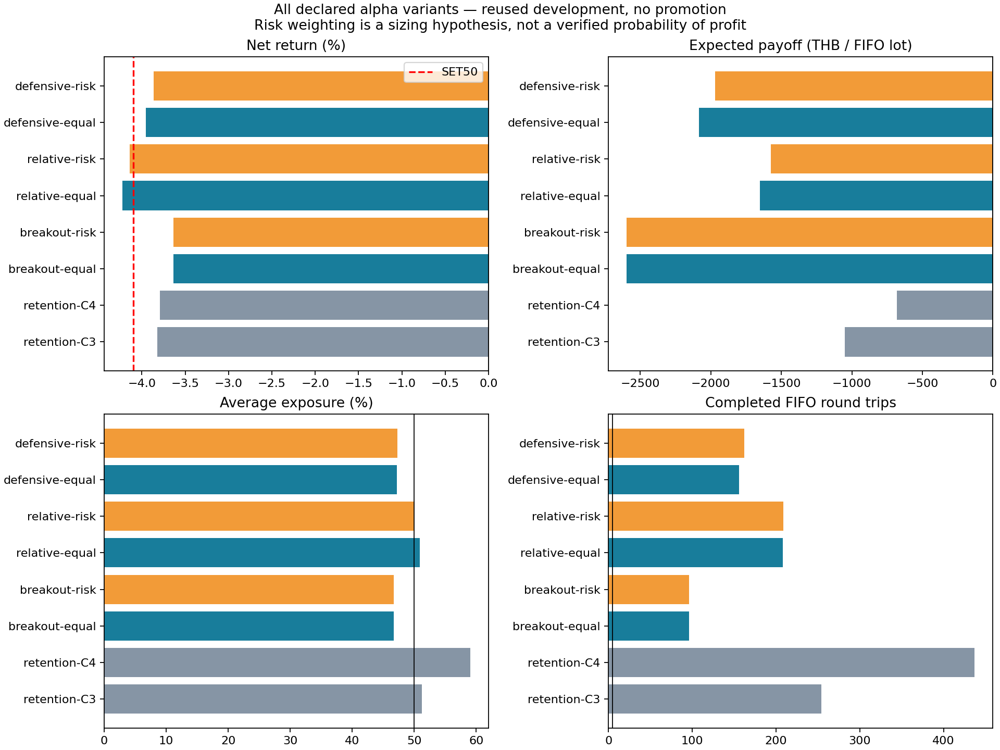
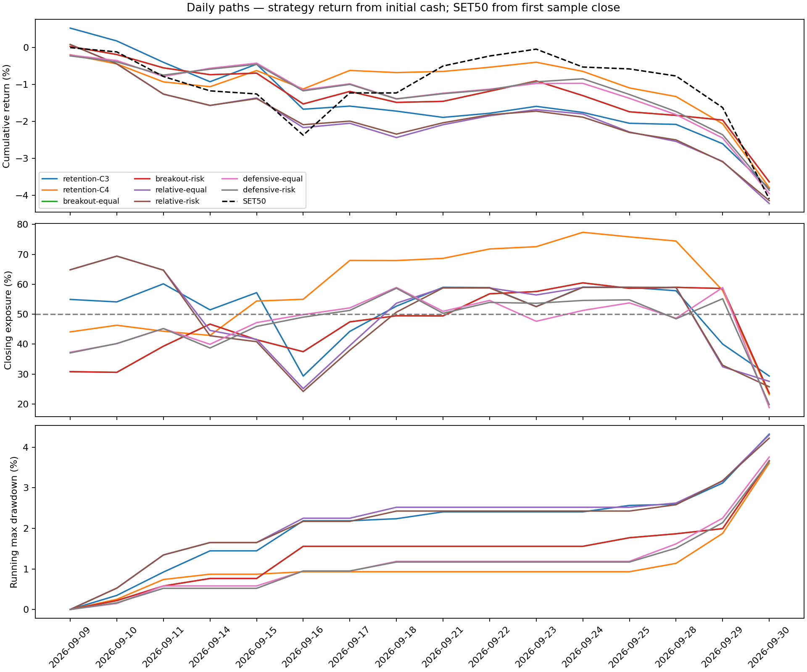
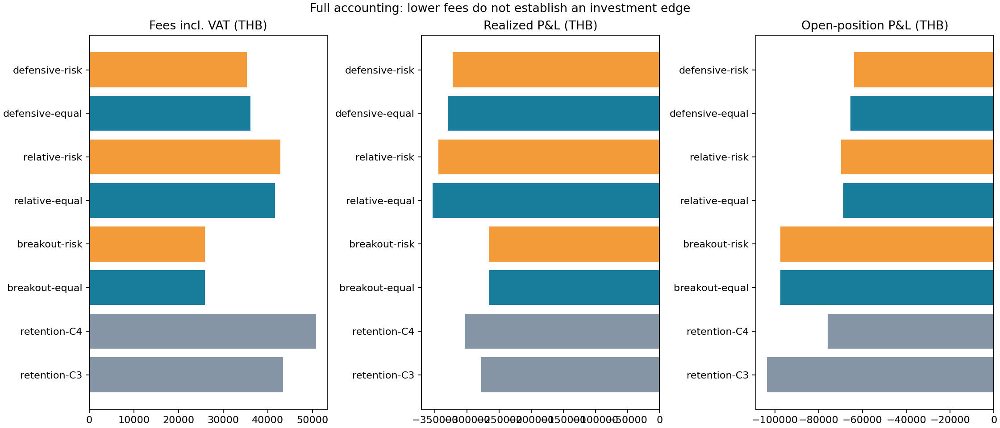

# Cost-aware alpha research results

All six declared variants and both retention controls. Reused 16-session September development sample; no independent validation.

[Strategy review](../../../research/phase5-alpha/strategy-review.md) · [Declaration](../../../research/phase5-alpha/experiment.md) · [Charts PDF](alpha-results.pdf) · [Machine-readable evidence](results.json)

| Strategy | Return % | Excess pp | MaxDD % | Exposure % | FIFO trips | Payoff THB | Common | Best Alpha |
| --- | ---: | ---: | ---: | ---: | ---: | ---: | --- | --- |
| retention-C3 | -3.8188 | 0.2807 | 4.3249 | 51.24 | 254 | -1050.75 | fail | fail |
| retention-C4 | -3.7931 | 0.3064 | 3.6088 | 59.04 | 437 | -679.10 | fail | fail |
| breakout-equal | -3.6368 | 0.4627 | 3.6666 | 46.71 | 96 | -2596.02 | fail | fail |
| breakout-risk | -3.6368 | 0.4627 | 3.6666 | 46.71 | 96 | -2596.02 | fail | fail |
| relative-equal | -4.2229 | -0.1234 | 4.3044 | 50.89 | 208 | -1652.39 | fail | fail |
| relative-risk | -4.1429 | -0.0434 | 4.2246 | 50.07 | 209 | -1573.47 | fail | fail |
| defensive-equal | -3.9539 | 0.1456 | 3.7595 | 47.20 | 156 | -2082.80 | fail | fail |
| defensive-risk | -3.8652 | 0.2343 | 3.6490 | 47.30 | 162 | -1968.83 | fail | fail |

breakout: equal and risk weighting produced identical final metrics. Position/liquidity/sector capacities and execution constraints can eliminate proposed weight differences; this pair does not establish a weighting advantage.

## Trade quality diagnostics

| Strategy | Closed position episodes | Open episodes | FIFO win rate % | Profit factor | Payoff 95% symbol-cluster interval THB |
| --- | ---: | ---: | ---: | ---: | --- |
| retention-C3 | 14 | 8 | 12.20 | 0.184 | -1592.40 to -486.55 |
| retention-C4 | 29 | 11 | 30.21 | 0.335 | -1348.18 to -116.80 |
| breakout-equal | 7 | 6 | 5.21 | 0.041 | -3878.53 to -1577.58 |
| breakout-risk | 7 | 6 | 5.21 | 0.041 | -3878.53 to -1577.58 |
| relative-equal | 16 | 8 | 14.90 | 0.038 | -2553.90 to -963.53 |
| relative-risk | 16 | 8 | 13.40 | 0.042 | -2335.08 to -944.13 |
| defensive-equal | 12 | 5 | 12.82 | 0.092 | -2892.61 to -1151.17 |
| defensive-risk | 12 | 6 | 12.96 | 0.093 | -2893.16 to -1026.16 |

Intervals are descriptive resampling by symbol, not independent validation or future profit probabilities. Shared market dependence and strategy selection remain. Win rate and profit factor describe completed FIFO lots; inspect open P&L alongside them.

## Largest net loss contributors

Contributions include commissions, realized sales and remaining marked holdings. These are retrospective diagnostics, not a ticker exclusion list.

| Strategy | Three largest net loss contributors (THB) |
| --- | --- |
| breakout-equal | CCET: -45,328; KKP: -45,278; CPF: -42,377 |
| breakout-risk | CCET: -45,328; KKP: -45,278; CPF: -42,377 |
| relative-equal | BCP: -70,531; TOP: -60,512; CPF: -39,320 |
| relative-risk | BCP: -59,475; TOP: -46,577; PTTEP: -41,220 |
| defensive-equal | BCP: -90,707; PTTEP: -66,160; EGCO: -39,672 |
| defensive-risk | BCP: -89,131; PTTEP: -52,564; EGCO: -46,713 |

**0/6 new variants pass the measured Best Alpha gates.** A passing local replay would not establish prize acceptance or future profitability.





The source and thresholds were declared before these replays. No failed variants are omitted. All 96 new strategy-days reconcile cash, positions, NAV, realized P&L, FIFO trips and payoff against the official engine. Artifact SHA-256 values are verified by the report builder and included in results.json.

FIFO counts are completed engine lots and can be fragmented by partial fills; they are not independent trading ideas. Exposure differs between models, so return changes are not evidence of improved stock selection at matched exposure. Drawdown is the official daily-close metric; controls do not guarantee an intraday loss ceiling. Only 48 supplied names are available.

## Reproduction

```bash
.venv/bin/python scripts/run_alpha_experiment.py --output artifacts/alpha-repeat
.venv/bin/python scripts/build_alpha_results.py --runs artifacts/alpha-repeat --output artifacts/alpha-report-repeat
```

The builder also requires the existing verified artifacts/retention-C3 and artifacts/retention-C4 controls. The literal quality config suffix means risk sizing in this experiment, not estimated profitability.


## Decision

No strategy is promoted. The best new return, breakout -3.6368%, improves on
retained C3 by 0.1820 percentage points, but exposure falls below eligibility
and payoff worsens. Its 96 FIFO trips represent only seven closed position
episodes. Relative strength loses more than SET50; defensive pullbacks do not
beat the C3/C4 retention controls. All new payoff intervals remain below zero.
The results do not support claims of high win probability or prize readiness.

The cost/retention/risk changes were bundled and exposure differs, so the return
change cannot be attributed to better stock selection. Preserve the engineering
risk tests, but reject promotion of these trading variants. Further parameter
search on the same 16 sessions cannot supply independent evidence. See
[next research](../../to-do/alpha-research-next.md) for the required comparison
and new-data protocol.

