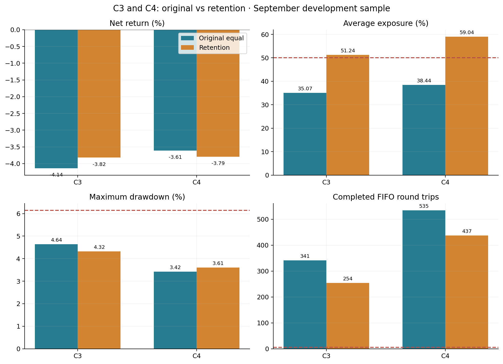
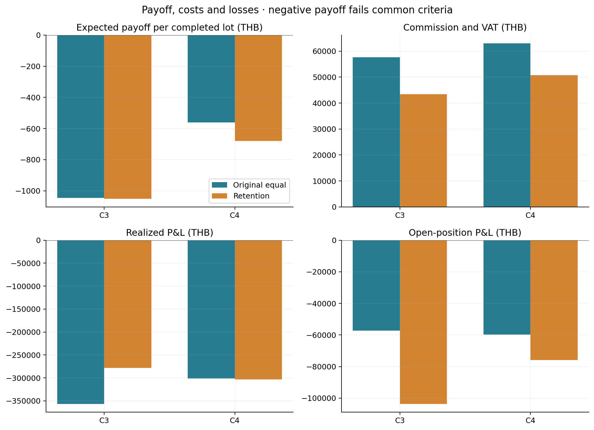
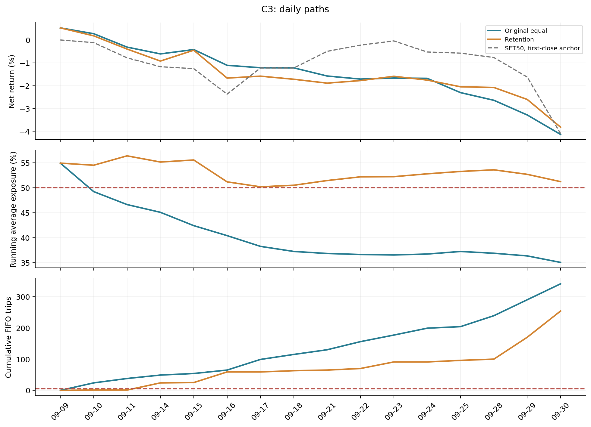
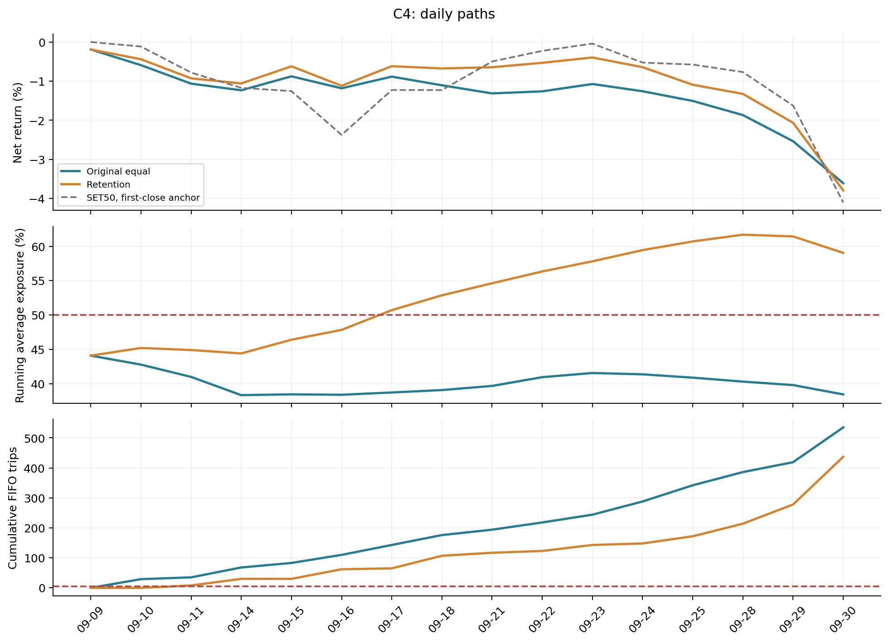

# Retention-only research comparison

9 November 2026. Both replays use the same 16 September sessions as Phase 5;
this is reused development data, not independent validation. The only changed
policy preserves opening quantities of held names that no longer pass the entry
filter. Existing stops, profit exits, portfolio guard and execution remain active.

| Model | Policy | Return % | Exposure % | Max DD % | FIFO trips | Payoff THB | Fees THB | Open P&L THB |
| --- | --- | ---: | ---: | ---: | ---: | ---: | ---: | ---: |
| C3 | Phase 5 equal | -4.137 | 35.069 | 4.642 | 341 | -1,044.74 | 57,701 | -57,331 |
| C3 | Retention | -3.819 | 51.237 | 4.325 | 254 | -1,050.75 | 43,367 | -103,574 |
| C4 | Phase 5 equal | -3.608 | 38.439 | 3.424 | 535 | -559.95 | 63,039 | -59,821 |
| C4 | Retention | -3.793 | 59.042 | 3.609 | 437 | -679.10 | 50,811 | -75,922 |

[Five-page visual report (PDF)](retention-results.pdf) · [Daily data](data.json)









Both retention versions meet the 50% exposure and >5 FIFO-trip targets and
remain below the 6.149244% drawdown boundary. Both fail common criteria because
payoff is negative, and fail Best Alpha because net return is negative. C3's
return improves by 0.318 percentage points and fees fall by THB 14,334, but its
payoff slightly worsens and open loss rises. C4's return worsens by 0.185 points
and payoff deteriorates despite saving THB 12,228 in fees. Exposure changes by
16.17 and 20.60 percentage points, respectively, so the return differences are
not exposure-matched comparisons. The result supports retaining this idea for
further research, not promotion or a claim of profitability.

All 32 replay strategy-days reconciled cash, holdings, fees, NAV and FIFO with
the official engine. A targeted test verifies that loss of an entry signal does
not force a sale and a volatility stop still sells. Position/sector limits can
still drift, retained holdings can crowd out new names, and intraday state is
not durable across restarts. No final sample liquidation was forced.

[Machine-readable metrics and run hashes](results.json) ·
[Declaration and research source](../../../research/phase5-retention/) ·
[Original Phase 5 comparison](../phase-5/phase-5-results.md)

Reproduce after installing the checksum-pinned official package and Python 3.13:

```bash
.venv/bin/python -m unittest discover -s tests -p test_phase5_retention.py -v
.venv/bin/python scripts/run_retention_experiment.py --output artifacts/retention-repeat
.venv/bin/python scripts/build_retention_visualisation.py \
  --c3 artifacts/retention-repeat/C3 --c4 artifacts/retention-repeat/C4 \
  --output artifacts/retention-visuals
```

The runner stages the research strategy separately and refuses to overwrite an
existing output directory. The original baseline and frozen Phase 5 files remain
unchanged. Additional permitted tick data and effective-dated membership are
needed before independently validating or selecting a candidate.
